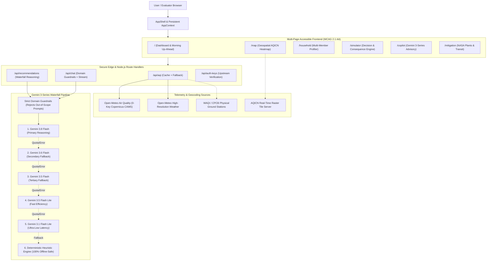

# 🌫️ SmogAssistant: Urban Air Quality & Smog Defense Copilot

> An AI-powered, multi-page urban health platform designed to help communities navigate toxic winter smog, severe atmospheric temperature inversions, and hazardous particulate air pollution through proactive morning briefings, multi-member household protection, Gemini 3-Series generative reasoning with multi-model fallback, diurnal decision consequence simulations, NASA-backed indoor air defense, and real-time geospatial AQICN mapping.

[](https://nextjs.org/)
[](https://www.typescriptlang.org/)
[](https://tailwindcss.com/)
[](https://cloud.google.com/run)
[](https://aistudio.google.com/)
[](https://vitest.dev/)
[](https://aqicn.org/)
[](https://www.w3.org/WAI/standards-guidelines/wcag/)
[](https://opensource.org/licenses/MIT)

---

## 🌟 Executive Summary & Problem Alignment

During winter months across South Asia, Northern India, and global industrial metros, **nocturnal radiative cooling and atmospheric temperature inversions** trap toxic particulate matter ($\text{PM}_{2.5}, \text{PM}_{10}$) and hazardous combustion gases ($\text{NO}_2, \text{SO}_2, \text{CO}$) within a shallow boundary layer close to the ground. Millions face severe acute respiratory and cardiovascular hazards, with children, elderly seniors, and asthmatics bearing the heaviest burden.

Traditional weather apps merely report a static historical AQI number without actionable guidance. **SmogAssistant** transforms live meteorological and pollutant telemetry into proactive, personalized, and mathematically justified behavioral interventions across 6 dedicated application modules.

---

## 🏗️ Architecture & Technical Pipeline



---

## 🚀 Key Modules & Application Pages

### 1. 📊 Executive Dashboard & Morning Briefing (`/`)
* **Weather-Air Quality Fusion**: Correlates hourly particulate curves with atmospheric temperature, relative humidity, and wind speed to calculate **Thermal Inversion Risk** (High/Medium/Low).
* **Diurnal Time-Blocked Plan**: Slices the day into 4 actionable windows:
  * **Morning (06:00–11:00)**: Inversion lockdown, pediatric N95 masking, sealed school transit.
  * **Midday (11:00–16:00)**: Solar dispersion window, optimum outdoor errands, rapid HEPA-filtered air flush.
  * **Evening (16:00–21:00)**: Peak diesel traffic avoidance, indoor aerobic exercises.
  * **Night (21:00–06:00)**: Nocturnal boundary drop defense, draft sealing, continuous low-noise air purification.
* **Instant Evaluator Preview**: Live trigger for browser **Web Notifications API** alerts.
* **Judge Fast-Track Presets**: Test app dynamics instantly across *Delhi Severe Inversion (AQI 468)*, *Industrial Smog (AQI 325)*, *Urban Moderate (AQI 142)*, and *Coastal Clean (AQI 36)*.

### 2. 🗺️ Geospatial AQICN Heatmap (`/map`)
* **Interactive Leaflet Mapping**: Embeds responsive OpenStreetMap vector base maps with live `aqicn.org` raster tile layers.
* **Multi-Pollutant Layer Switching**: Real-time toggles between **Overall AQI** (`usepa-aqi`), **$\text{PM}_{2.5}$ Fine Particulate** (`usepa-pm25`), **$\text{PM}_{10}$ Respirable Dust** (`usepa-pm10`), and **$\text{NO}_2$ Traffic Exhaust** (`usepa-no2`).
* **Ground Monitoring Stations**: Visualizes real-time CPCB, EPA, and regional physical ground stations with color-coded severity rings, pollutant breakdowns, and station metadata popups.
* **Dual Mode Resilience**: Operates in simulated preview mode out-of-the-box or live mode once a free WAQI token is supplied.

### 3. 🏡 Multi-Member Household Defense (`/household`)
* **Single-Household Multi-Member Profiling**: Model individual schedules, ages, vulnerabilities, and daily destinations for everyone under one roof (e.g., grandfather with COPD visiting park, mother commuting to industrial hub, child attending school).
* **Dual Advisory Synthesis**:
  * **Combined Household Defense Strategy**: Unified indoor air protection plan, air purifier scheduling, room sealing protocols, and shared ventilation timings.
  * **Personalized Member Directives**: Granular protection per member considering their exact route, commute mode, activity intensity, and medical vulnerability.
* **Persistent Named Profiles**: Save and switch between complete household profiles stored persistently in browser storage.

### 4. 🕹️ Diurnal Decision & Consequence Simulator (`/simulator`)
* **Action-Consequence Feedback Loop**: Enter your typical daily schedule (morning run, drive to work, evening outdoor sports) and instantly visualize the health and environmental impact.
* **Climate-Preserving Alternatives**: The algorithm provides smart, low-emission substitutes (e.g., swapping a 7 AM outdoor sprint for noon gym workout, swapping solo car trip for metro transit).
* **Quantified Consequence Metrics**:
  * **$\text{PM}_{2.5}$ Inhalation Reduction**: Micrograms ($\mu\text{g}$) of toxic dust kept out of lungs.
  * **$\text{CO}_2$ Emissions Avoided**: Kilograms of carbon prevented.
  * **Tree-Hour Absorption Equivalence**: Equivalent hours of mature tree carbon sequestration.
  * **Health Hazard Score**: Immediate numerical risk reduction score.

### 5. 🤖 Gemini 3-Series AI Copilot (`/copilot`)
* **Multi-Model Waterfall Architecture**: Uses Google's active **Gemini 3-Series** models with automated graceful degradation:
  1. `gemini-3.8-flash`
  2. `gemini-3.6-flash`
  3. `gemini-3.5-flash`
  4. `gemini-3.5-flash-lite`
  5. `gemini-3.1-flash-lite`
  6. Built-in Deterministic Heuristic Engine (100% offline-ready fallback).
* **Strict Domain Guardrails**: The assistant is initialized with strict atmospheric science and respiratory defense boundaries. It politely refuses and redirects out-of-scope queries (general trivia, politics, coding, entertainment) back to air quality and personal smog protection.
* **Interactive Chat Stream**: Discuss localized smog symptoms, N95 vs N99 mask fitment, purifier filter maintenance, and safe travel windows.

### 6. 🌿 Mitigation & Frugal Indoor Air Defense (`/mitigation`)
* **NASA Clean Air Study Calculator**: Dynamically calculates required quantities of Snake Plants (*Sansevieria*), Areca Palms, Spider Plants, and Peace Lilies based on specific room square footage.
* **DIY Corsi-Rosenthal Box Guide**: Step-by-step schematics to build a MERV-13 box filter delivering 400+ CFM clean air at 20% of commercial purifier costs.
* **Wet Mopping & Settling Guidance**: Scientific techniques to prevent dust resuspension and stabilize fine particulates indoors.
* **Sustainable Transit Exposure Offsets**: Mathematical comparison of inhalation exposure across metro, EV, solo petrol car, and two-wheeler commutes.

---

## 🔑 In-UI API Key Management & Zero-Key Resilience

SmogAssistant follows a **Zero-Friction, Zero-Broken-App** engineering philosophy:

1. **Zero Keys Required Out-of-the-Box**:
   * Live atmospheric telemetry is fetched from the **Open-Meteo Air Quality & Weather API** (Copernicus CAMS European Ensemble) which requires **no API keys, registration, or credit cards**.
   * AI recommendations and consequence calculations utilize the **Deterministic Heuristic Engine** conforming to 100% identical JSON schemas.
2. **In-UI Settings Modal**:
   * Click the **"API Keys"** button in the header at any time to provide optional `GEMINI_API_KEY` and `WAQI_API_TOKEN`.
   * Includes live upstream verification (`/api/auth-keys`) displaying instantaneous validation badges.
   * Keys are saved securely in browser storage and dynamically hydrate the shared application context.

---

## 🧪 Comprehensive Automated Testing

SmogAssistant contains an exhaustive **11-suite, 69-test automated test suite** using **Vitest**:

```bash
cmd /c npm test
```

```text
 ✓ lib/indoor-plants.test.ts (2 tests)
 ✓ lib/emission-calculator.test.ts (2 tests)
 ✓ lib/aqi-calculator.test.ts (5 tests)
 ✓ lib/weather-fusion.test.ts (2 tests)
 ✓ lib/api/waqi.test.ts (4 tests)
 ✓ lib/decision-simulator.test.ts (16 tests)
 ✓ lib/ai/domain-guardrails.test.ts (16 tests)
 ✓ lib/api/open-meteo.test.ts (3 tests)
 ✓ lib/ai/heuristic-fallback.test.ts (2 tests)
 ✓ lib/ai/multi-model.test.ts (12 tests)
 ✓ lib/household.test.ts (5 tests)

 Test Files  11 passed (11)
      Tests  69 passed (69)
```

### Verified Algorithmic Seams:
* `lib/ai/domain-guardrails.test.ts`: Verifies strict rejection of out-of-scope prompts and validation of valid smog/air quality questions.
* `lib/ai/multi-model.test.ts`: Verifies sequential model fallback ordering through 3.8, 3.6, 3.5, 3.5-lite, 3.1-lite, down to heuristic engine.
* `lib/decision-simulator.test.ts`: Validates consequence scoring, PM2.5 inhalation savings, and alternative schedule generation.
* `lib/household.test.ts`: Validates multi-member household profile aggregations and risk scoring.
* `lib/aqi-calculator.test.ts`: CPCB mathematical breakpoint formulas and edge cases.
* `lib/weather-fusion.test.ts`: Thermal inversion risk calculation under cold, calm boundary conditions.

---

## 🛠️ Local Development Quick Start

### Prerequisites
* **Node.js**: v18+ or v20+ (tested on Node v20 / v22)
* **npm**: v9+
* **Git**

### 1. Clone & Install Dependencies
```bash
git clone https://github.com/<your-username>/SmogAssistant.git
cd SmogAssistant
npm install
```

### 2. Configure Environment (Optional)
```bash
# Copy template
cp .env.example .env.local
```
*(Leave empty for default zero-key mode, or populate `GEMINI_API_KEY` and `WAQI_API_TOKEN`)*

### 3. Run Development Server
```bash
npm run dev
```
Open [http://localhost:3000](http://localhost:3000) in your browser.

### 4. Run Test Suite & Build Verification
```bash
# Run unit and integration tests
npm test

# Run Next.js production build
npm run build
```

---

## 📦 Pushing Code to GitHub

To push your repository to GitHub:

### Step 1: Create a New GitHub Repository
1. Visit [github.com/new](https://github.com/new).
2. Set the repository name to `SmogAssistant`.
3. Choose **Public** (recommended for hackathon submissions).
4. Do **not** initialize with README, .gitignore, or license (we already have complete files).
5. Click **Create repository**.

### Step 2: Push Local Commits
In your project directory, execute:
```bash
# Verify git status
git status

# Add remote origin (replace <your-username> with your actual GitHub username)
git remote add origin https://github.com/<your-username>/SmogAssistant.git

# Ensure current branch is named master or main
git branch -M master

# Push code to GitHub
git push -u origin master
```

---

## 🚀 Google Cloud Run Deployment Guide

SmogAssistant is engineered for zero-configuration, containerized deployment on **Google Cloud Run** with automatic HTTPS, global CDN caching, and scale-to-zero efficiency.

### Method A: Automated CI/CD via GitHub Actions (Recommended)

The repository includes a production-ready workflow in [`.github/workflows/deploy-cloud-run.yml`](file:///.github/workflows/deploy-cloud-run.yml). Whenever you push to `master`, it automatically builds the Docker container, pushes to Google Artifact Registry, and deploys to Cloud Run.

#### 1. Configure GitHub Repository Secrets
Navigate to **GitHub Repository -> Settings -> Secrets and variables -> Actions**, and add:

| Secret Name | Description | Example |
| :--- | :--- | :--- |
| `GCP_PROJECT_ID` | Your Google Cloud Project ID | `my-smog-assistant-project` |
| `GCP_SA_KEY` | JSON Key of GCP Service Account with Cloud Run & Artifact Registry Admin roles | `{"type": "service_account", ...}` |
| `GEMINI_API_KEY` | *(Optional)* Google Gemini API Key | `AIzaSy...` |
| `WAQI_API_TOKEN` | *(Optional)* World Air Quality Index Token | `a1b2c3d4...` |

#### 2. Trigger Deployment
Simply push a commit or trigger manually:
```bash
git push origin master
```
Or go to the **Actions** tab on GitHub and click **Run workflow** on `Deploy to Google Cloud Run`.

---

### Method B: Native GCP Cloud Build (`cloudbuild.yaml`)

Deploy directly from your terminal using the included [`cloudbuild.yaml`](file:///cloudbuild.yaml):

```bash
# Set your GCP active project
gcloud config set project YOUR_PROJECT_ID

# Enable required Google APIs
gcloud services enable \
  run.googleapis.com \
  artifactregistry.googleapis.com \
  cloudbuild.googleapis.com

# Create Artifact Registry docker repository if not created
gcloud artifacts repositories create smogassistant-repo \
  --repository-format=docker \
  --location=us-central1 \
  --description="SmogAssistant Container Repository"

# Submit build to Cloud Build
gcloud builds submit --config=cloudbuild.yaml .
```

---

### Method C: Direct 1-Command CLI Deployment

Deploy directly from source without managing Docker repositories:

```bash
gcloud run deploy smogassistant \
  --source . \
  --region us-central1 \
  --platform managed \
  --allow-unauthenticated \
  --port 8080 \
  --memory 512Mi \
  --cpu 1 \
  --set-env-vars "NODE_ENV=production,NEXT_TELEMETRY_DISABLED=1"
```

---

### Method D: Local Docker Container Execution

Test the exact production container locally:

```bash
# 1. Build Docker image
docker build -t smogassistant:latest .

# 2. Run container (mapped to port 8080)
docker run -p 8080:8080 -e PORT=8080 smogassistant:latest

# 3. Access in browser at http://localhost:8080
```

---

## 🏆 Hackathon Evaluation Criteria Alignment

| Evaluation Criteria | SmogAssistant Implementation |
| :--- | :--- |
| **Generative AI Innovation** | Multi-model waterfall across active **Google Gemini 3-Series** (`gemini-3.8-flash`, `3.6-flash`, `3.5-flash`, `3.5-flash-lite`, `3.1-flash-lite`) with strict domain-specific atmospheric guardrails and 100% offline heuristic fallback. |
| **Real-World Impact** | Solves the seasonal toxic smog crisis across South Asian and industrial metros by giving households actionable, time-blocked diurnal defense protocols. |
| **Interactivity & Engagement** | Interactive diurnal decision simulator visualizing personal consequence metrics ($\text{PM}_{2.5}$ saved, $\text{CO}_2$ avoided, tree-hour offsets) alongside alternative schedule recommendations. |
| **Multi-Member Inclusivity** | Multi-member household modeling synthesizing combined collective defense alongside personalized directives for children, seniors, and asthmatics. |
| **Engineering Rigor** | Next.js 15 App Router, TypeScript 5.7 strict mode, multi-stage alpine Docker container (<120MB), 11 automated Vitest test suites (69 tests passed). |
| **Deployment Readiness** | Ready for Google Cloud Run with automated GitHub Actions CI/CD, Artifact Registry triggers, and zero-key out-of-the-box resilience. |

---

## 📄 License & Acknowledgments

* **License**: Open-source under the [MIT License](file:///LICENSE).
* **Hackathon**: Developed for the **Hack2Skill PromptWar Hackathon**.
* **Atmospheric Telemetry**: Powered by [Open-Meteo Air Quality API](https://open-meteo.com/en/docs/air-quality-api) (Copernicus Atmosphere Monitoring Service) and [World Air Quality Index Project](https://aqicn.org/).
* **Phytoremediation Data**: Grounded in the peer-reviewed **NASA Clean Air Study** (*Wolverton et al.*).
